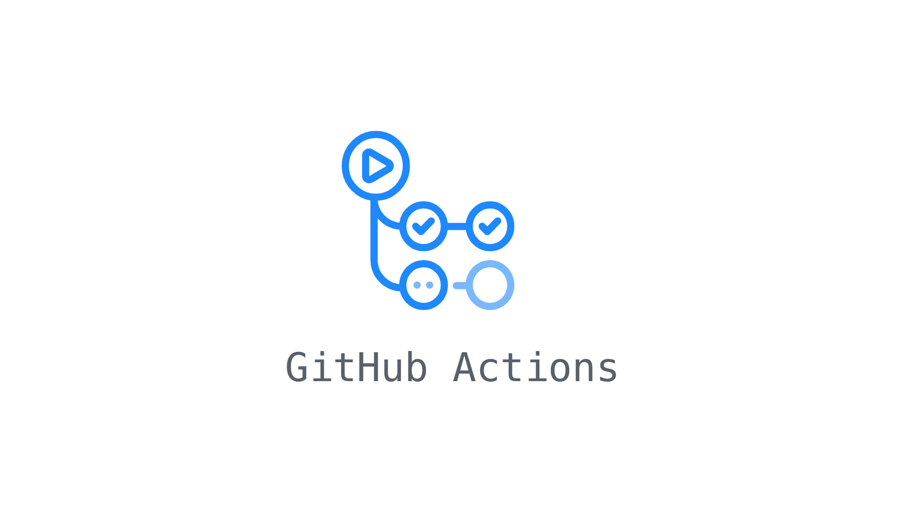

# ActionBot CI/CD
⏰ **自动更新源码发布容器**

[![Contributors][contributors-shield]][contributors-url]
[![Forks][forks-shield]][forks-url]
[![Stargazers][stars-shield]][stars-url]
[![Issues][issues-shield]][issues-url]

<br />
<p align="center">
  <a href="https://github.com/bigbugcc/ActionBot">
    
  </a>
  <h3 align="center">ActionBot CI/CD</h3>
  <p align="center">
    👉 自动更新源码发布容器
 [<a herf="https://github.com/bigbugcc/ActionBot/releases"> Releases </a>] 👈
    <br />
    <a href="https://hub.docker.com/u/bigbugcc">DockerHub</a>
    ·
    <a href="https://github.com/bigbugcc/ActionBot/actions">Action</a>
    ·
    <a href="https://github.com/bigbugcc/ActionBot/issues">提出新特性</a>
  </p>
</p>

## 目录
- [ActionBot Param](#ActionBot-Param)
- [3x-ui Docker](#3x-ui-Docker)
- [WarpPlus Docker](#WarpPlus-Docker)


## 项目列表statistics
|           项目         |         类别         |         Repo         |        Action         |            状态          |              统计            |              入口             |
| :------------------------: | :---------------------: | :-------------------: | :-------------------: | :--------------------------: | :--------------------------: | :--------------------------: |
|          3x-ui        |  Docker | [🚩](https://github.com/MHSanaei/3x-ui) |[🍕](https://github.com/bigbugcc/ActionBot/actions/workflows/3x-ui-Docker.yml) |  |   |[✔](https://hub.docker.com/r/bigbugcc/3x-ui)
|      Admin.NET     |  镜像库  | [🚩](https://gitee.com/zuohuaijun/Admin.NET) |[🍕](https://github.com/bigbugcc/ActionBot/actions/workflows/Admin.NET-Sync.yml) |  |   |  [✔](https://github.com/bigbugcc/Admin.NET)
|         OpenWRT       |  Build  | [🚩](https://github.com/coolsnowwolf/lede) |[🍕](https://github.com/bigbugcc/openwrts/actions/workflows/ActionTrigger.yml) |  |  |[✔](https://github.com/bigbugcc/OpenWrts)
|   WarpPlus-Traffic    |  Task   | [🚩](https://github.com/bigbugcc/ActionBot) |[🍕](https://github.com/bigbugcc/ActionBot/actions/workflows/WarpPlus-Traffic.yml) |  |  | [✔](https://github.com/bigbugcc/ActionBot/blob/main/bin/warp/warp.py)
|   WarpPlus-Docker     |  Docker | [🚩](https://github.com/bepass-org/warp-plus) |[🍕](https://github.com/bigbugcc/ActionBot/actions/workflows/WarpPlus-Docker.yml) |  |  |[✔](https://hub.docker.com/r/bigbugcc/warp-plus)|

# ActionBot-Param

### Hello
ActionBot 是一个监听自动化执行项目，支持两种运行模式：
- **Trigger 模式**（默认）：检测当前仓库下的`Workflow`并自动根据条件批量触发它们
- **Check 模式**：单个工作流内独立检查源仓库更新，若无更新则自动取消当前工作流运行

可用于跨平台`(GitHub <-> Gitee)`同步仓库、自动发布Releases、编译Docker和定时任务等；对于一些没有提供适合自己的容器或应用进行二次独立发布[Demo](#3x-ui-Docker)。

### Usage

#### Trigger 模式（批量触发其它 Workflow）
```yaml
    steps:
    - name: Checkout
      uses: actions/checkout@v4

    - name: AutoTrigger
      uses: bigbugcc/ActionBot@main
```

#### Check 模式（单工作流检查更新）
cron 定时触发后，自动抓取源仓库最新 commitId 并与缓存比对；若一致则直接取消当前工作流，若不一致则继续执行后续步骤。
```yaml
name: 3x-ui-Docker
on:
  schedule:
    - cron: '0 */6 * * *'
  workflow_dispatch:

jobs:
  build:
    runs-on: ubuntu-latest
    steps:
      - uses: actions/checkout@v4

      - name: Check for updates
        uses: bigbugcc/ActionBot@main
        with:
          mode: 'check'
          repo_url: 'https://github.com/MHSanaei/3x-ui'
          branch: 'main'

      # 以下步骤仅在源仓库有更新时执行，无更新时工作流已被自动取消
      - name: Build and Push Docker
        run: |
          echo "Source updated, building..."
```

### Action Param
| 参数 | 说明 | 必填 | 默认值 |
| --- | --- | --- | --- |
| `token` | 用于认证的 GitHub Token | ✅ | `${{ github.token }}` |
| `repository` | 仓库名称 | ✅ | `${{ github.repository }}` |
| `workflow` | 当前工作流名称 | ✅ | `${{ github.workflow }}` |
| `workspace` | 当前仓库工作目录 | ✅ | `${{ github.workspace }}` |
| `mode` | 运行模式：`trigger`（批量触发）/ `check`（单工作流检查） | ❌ | `trigger` |
| `repo_url` | 监听的仓库地址（check 模式使用） | ❌ | `''` |
| `branch` | 监听的分支名称，空则为仓库默认分支 | ❌ | `''` |

### Action Output
| 输出 | 说明 |
| --- | --- |
| `updated` | 源仓库是否有更新 `true` / `false`（仅 check 模式） |

### Trigger Param
```yaml
env:
  repo_url: '' 
  force_active: 1
```
- repo_url : 监听的仓库地址，根据该地址判断commitId是否变化，而触发当前`Workflow`；可以为空。
- force_active : `0，1，2`  
    `0` -> 默认值，会根据repo的值进行判断；   
    `1` -> 强制执行当前`Workflow`，不判断CommitId；  
    `2` -> 跳过执行，即使`Repo`不为空也会直接跳过；

# ActionBot Example
## 3x-ui-Docker
### 构建与版本标签

- 手动执行 workflow 时，`version_tag` 可填写官方正式版本 tag（`vX.Y.Z` 或 `X.Y.Z`）；留空或填写 `latest` 时，通过官方 latest Release 选择最新正式版，不构建 `main`。输入不存在的 tag、分支或 commit 会在构建前失败。
- 镜像标签跟随官方版本，例如 `bigbugcc/3x-ui:v3.9.0` 和 `bigbugcc/3x-ui:3.9.0`。所选版本为官方最新正式版时同时发布 `latest`；手动编译历史版本不会覆盖 `latest`，也不会将该次 Release 设为最新。
- 自动触发通过 `repo_release: latest` 跟踪官方正式发布及其 tag 的源码 SHA；普通 `main` 提交不再触发 3x-ui 编译。自动触发会将检测到的版本传入 `version_tag`。
- 构建先将官方 tag（包括 annotated tag）解析为固定 commit，再检出并核对 SHA。镜像 labels、Release 说明和 `source.json` 记录实际官方版本和源码 SHA；面板沿用官方版本信息。
- 源码检出及 SHA 校验后执行 `python3 bin/3x-ui/remove_sponsors.py workdir`，仅在已知 `SponsorList` 类型和 `GetSponsors()` 函数精确匹配时，让赞助接口返回空列表。这样关闭登录页、仪表盘、赞助页及旧版侧栏中使用该接口的付费广告，并停止该调用路径上的远程广告清单和 Logo 拉取；保留 API、捐赠入口、MTProto `adTag` 和管理员配置的订阅横幅。
- 脚本分别精确移除 `AppSidebar.tsx` 的赞助商菜单和 `CommandPalette.tsx` 的赞助商快捷入口，同时清理因此无用的图标导入、类型和映射。其他导航保持原样；图标新增用途或菜单结构变化时跳过该文件。本步骤不删除赞助页路由，已知地址仍可直接访问。
- 三项补丁分别使用同目录临时文件及原子替换。某项遇到文件缺失、结构变化或写入失败时，保留该文件并警告、跳过，不影响其他项和正常构建；解释器或脚本异常也不会阻断构建。构建摘要和 Release 说明分别记录后端赞助接口、侧栏菜单和命令面板入口的 `applied`（已应用）、`already-applied`（已应用过或入口已不存在）、`skipped`（安全跳过）或 `failed`（脚本/状态记录失败），避免将部分成功误报为全部成功。`skipped`/`failed` 时广告或入口可能保留；状态仅说明已知补丁的执行结果，不保证未来新增广告已被覆盖。此可选补丁的容错不改变其他构建、架构校验和发布步骤的失败处理。
- 构建首先推送唯一临时标签 `build-<run_id>-<attempt>`；五个平台校验和离线包导出成功后，才将同一镜像 digest 发布到对外标签，并核对发布后的 digest。校验失败不会更新 `latest` 或版本标签；Release 上传失败时已发布镜像仍然有效。
- 镜像与 Release 发布成功后，按 Docker Hub 标签推送时间保留最近 **10 个版本标签**（`vX.Y.Z` 和 `X.Y.Z` 分别计数，通常约 5 个版本），`latest` 额外保留；重编历史版本按本次推送时间计入。清理同时删除本次成功构建的临时标签和本次构建开始前遗留的 `build-*` 标签，其他标签（如 `dev`、`sha-*`）保留。删除按标签名执行，不直接删除共享 digest；GitHub Release 和离线包不受影响。
- 清理复用 `DOCKERHUB_USERNAME`、`DOCKERHUB_TOKEN`，其中 token 必须有 **Read, Write, Delete** 权限（[Docker PAT 文档](https://docs.docker.com/security/access-tokens/personal-access-tokens/)）。API 失败或标签列表不完整时停止清理并发出警告，已发布的镜像与 Release 仍有效；可能已完成部分删除，下次成功发布会再次清理。可修改 workflow 的 `keep_version_tags` 调整数量，或执行 `python3 bin/3x-ui/cleanup_tags.py --repo bigbugcc/3x-ui --keep 10` 只读预览版本标签清理计划。
- 源码 commit 时间和实际 workflow 运行时间分别记录于镜像 labels、`source.json` 和 Release 说明。
- 支持 `linux/386`、`linux/amd64`、`linux/arm64/v8`、`linux/arm/v7`、`linux/arm/v6`。各平台都提供 `.tar.gz` 离线镜像，下载后先执行 `sha256sum -c SHA256SUMS`，再用 `gzip -dc 3x-ui-ARCH-VERSION.tar.gz | docker load` 导入；导入后的标签为 `bigbugcc/3x-ui:VERSION-ARCH`，其中 ARCH 为 `386`、`amd64`、`arm64`、`armv7` 或 `armv6`。
- 构建沿用所选官方 tag 的 Dockerfile，应用上海时区、架构映射和缓存分层补丁；上游结构变化时会明确失败，避免静默打包错误。缓存保留编译层，Xray、MTG 和规则资源在每次构建时重新下载。

Docker Usage  

- 项目地址 https://github.com/MHSanaei/3x-ui
```bash
docker run -itd \
   -e XRAY_VMESS_AEAD_FORCED=false \
   -v $PWD/db/:/etc/x-ui/ \
   -v $PWD/cert/:/root/cert/ \
   --network=host \
   --restart=unless-stopped \
   --name 3x-ui \
   bigbugcc/3x-ui:latest
```
上述示例跟随官方最新正式版；固定版本时，将镜像标签改为所需的官方 tag，例如 `v3.9.0`。
#### Default Setting
- **Port:** 2053
- **TimeZone:** Asia/Shanghai
- **Username & Password:** It will be generated randomly if you skip modifying.
- **Database Path:**
  - /etc/x-ui/x-ui.db
- **Xray Config Path:**
  - /usr/local/x-ui/bin/config.json
- **Web Panel Path w/o Deploying SSL:**
  - http://ip:2053/panel
  - http://domain:2053/panel
- **Web Panel Path w/ Deploying SSL:**
  - https://domain:2053/panel

## WarpPlus-Docker
Repo：https://github.com/bigbugcc/ActionBot  
warp-plus：https://github.com/bepass-org/warp-plus

### Default Setting
- **Port:** 1080
- **Warp Config Path:**
  - /etc/warp/config.json
### Parameter
`/etc/warp/config.json`
```shell
NAME
  warp-plus

FLAGS
  -4                       only use IPv4 for random warp endpoint
  -6                       only use IPv6 for random warp endpoint
  -v, --verbose            enable verbose logging
  -b, --bind STRING        socks bind address (default: 127.0.0.1:8086)
  -e, --endpoint STRING    warp endpoint
  -k, --key STRING         warp key
      --dns STRING         DNS address (default: 1.1.1.1)
      --gool               enable gool mode (warp in warp)
      --cfon               enable psiphon mode (must provide country as well)
      --country STRING     psiphon country code (valid values: [AT BE BG BR CA CH CZ DE DK EE ES FI FR GB HR HU IE IN IT JP LV NL NO PL PT RO RS SE SG SK UA US]) (default: AT)
      --scan               enable warp scanning
      --rtt DURATION       scanner rtt limit (default: 1s)
      --cache-dir STRING   directory to store generated profiles
      --tun-experimental   enable tun interface (experimental)
      --fwmark UINT        set linux firewall mark for tun mode (default: 4981)
      --reserved STRING    override wireguard reserved value (format: '1,2,3')
      --wgconf STRING      path to a normal wireguard config
  -c, --config STRING      path to config file
      --version            displays version number
```
### Usage
Modify config '/etc/warp/config.json'

```bash
docker run -itd \
   -v /etc/warp/:/etc/warp/ \
   --network=host \
   --restart=unless-stopped \
   --name warp-plus \
   bigbugcc/warp-plus:latest
```


<!-- links -->
[contributors-shield]: https://img.shields.io/github/contributors/bigbugcc/ActionBot?style=flat-square
[contributors-url]: https://github.com/bigbugcc/ActionBot/graphs/contributors
[forks-shield]: https://img.shields.io/github/forks/bigbugcc/ActionBot?style=flat-square
[forks-url]: https://github.com/bigbugcc/ActionBot/network/members
[stars-shield]: https://img.shields.io/github/stars/bigbugcc/ActionBot?style=flat-square
[stars-url]: https://github.com/bigbugcc/ActionBot/stargazers
[issues-shield]: https://img.shields.io/github/issues/bigbugcc/ActionBot?style=flat-square
[issues-url]: https://img.shields.io/github/issues/bigbugcc/ActionBot
